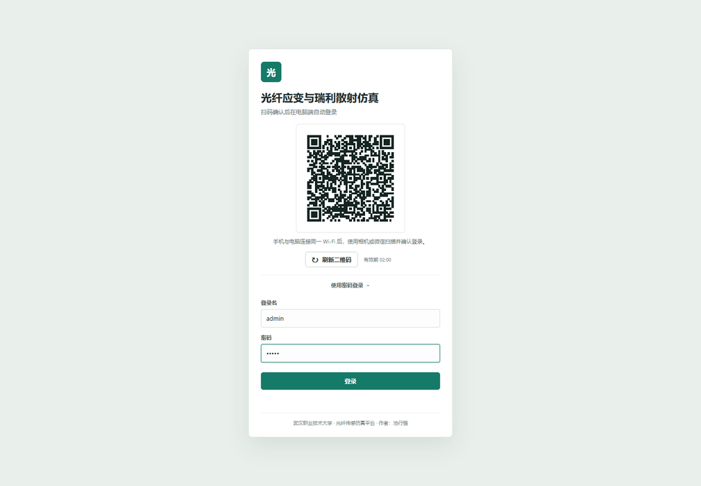
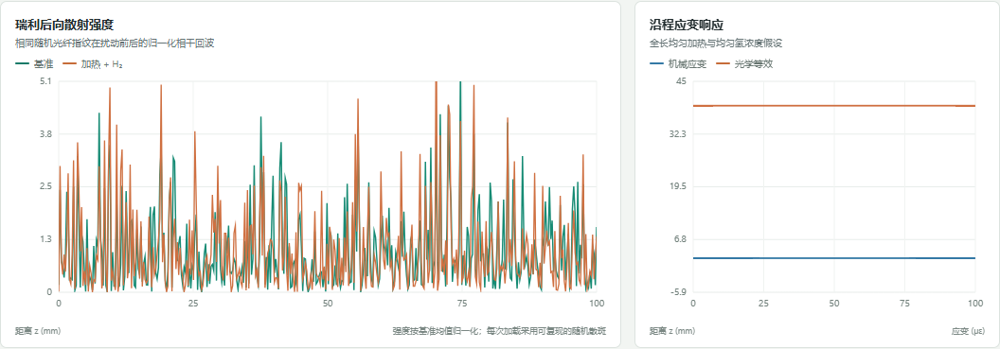
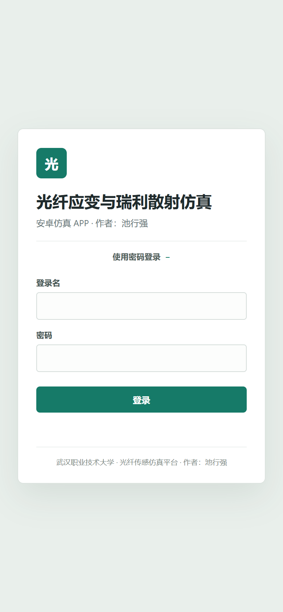
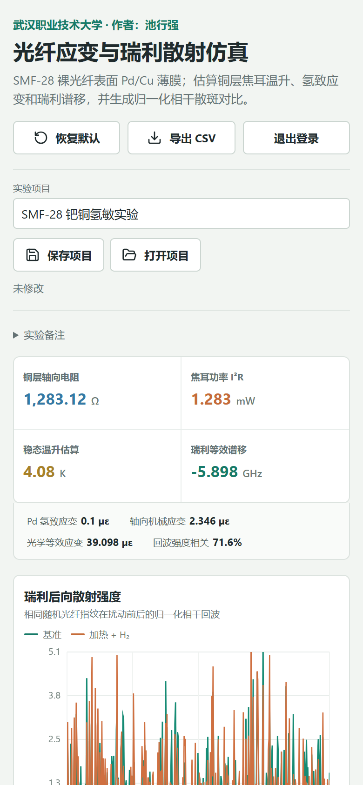
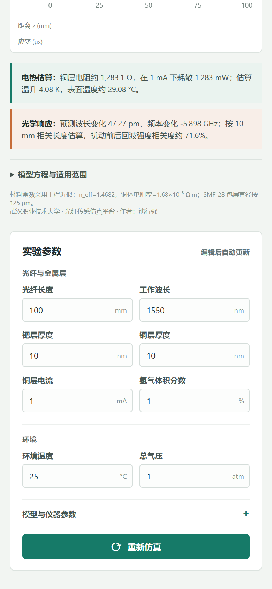

# 操作演示与结果

武汉职业技术大学 · 作者：池行强

## 录屏

[播放 WebM 录屏](https://github.com/AIsky001/fiber-rayleigh-simulator/blob/main/docs/media/simulator-demo.webm)

录屏来自本机 Chrome 中的共享页面，桌面视口为 1440 × 1000。录屏中通过真实网页接口完成 `admin/admin` 登录、项目保存和 CSV 下载；不是安卓真机录像。

操作顺序：

1. 展开“使用密码登录”，输入 `admin` / `admin`，进入默认实验。
2. 将铜层电流从 1 mA 改为 2 mA，观察功率和曲线变化。
3. 将氢气体积分数从 1% 改为 2%。
4. 修改项目名称，点击“保存项目”，下载可再次编辑的 JSON。
5. 点击“导出 CSV”，下载当前近似模型的沿程曲线。
6. 导入 [2 mA 对比示例](../examples/smf28-current-2ma.json)，再导入[默认示例](../examples/smf28-default.json)，恢复默认条件。

## 默认输出

条件为 SMF-28，裸石英包层直径 125 µm，长度 100 mm，Pd 10 nm、Cu 10 nm，电流 1 mA，氢气体积分数 1%，波长 1550 nm，环境温度 25 °C、总气压 1 atm。铜薄膜电阻率倍率为 3，等效散热系数为 8 W/(m²·K)，氢致传递系数为 0.1 µε/(1% H₂)，相关长度为 10 mm。

| 指标 | 页面显示值 |
| --- | --- |
| 铜层轴向电阻 | 1,283.12 Ω |
| 焦耳功率 | 1.283 mW |
| 稳态温升 | 4.08 K |
| Pd 氢致应变 | 0.1 µε |
| 轴向机械应变 | 2.346 µε |
| 光学等效应变 | 39.098 µε |
| 瑞利等效谱移 | −5.898 GHz |
| 回波强度相关 | 71.6% |

只将电流改为 2 mA 时，功率显示为 5.132 mW。在当前恒定电阻近似下，功率和温升与电流平方成正比。图表和表格均为程序的近似计算结果，非实测结果或 COMSOL 求解图。

## 手机预览

  

手机预览视口为 390 × 844，使用浏览器和模拟的 Android 登录接口。检查了页面宽度和参数布局，尚未验证安卓真机安装、原生文件选择器和不同 WebView 版本。预览图不包含 Android 状态栏。

## 已核对的操作

| 检查 | 结果 |
| --- | --- |
| 网页密码登录 | 进入仿真页面 |
| 默认瑞利与应变 Canvas | 均绘出非空曲线 |
| 1 mA 改为 2 mA | 功率由 1.283 mW 变为 5.132 mW |
| 保存项目 | JSON 包含当前参数、池行强和武汉职业技术大学署名 |
| CSV 下载 | 包含距离、归一化回波强度和应变列 |
| 两个示例导入 | 参数按示例更新 |
| 手机宽度 | 无横向溢出 |
| 页面运行日志 | 本次检查没有脚本错误；浏览器 favicon 请求单独返回空响应 |

本次检查使用 Playwright 驱动本机 Chrome，录制过程中未修改应用页面或计算模型。参数校准、模型适用条件及 COMSOL 参数独立性见[模型说明](../outputs/COMSOL模型说明.md)和[仓库首页](../README.md#适用范围)。
